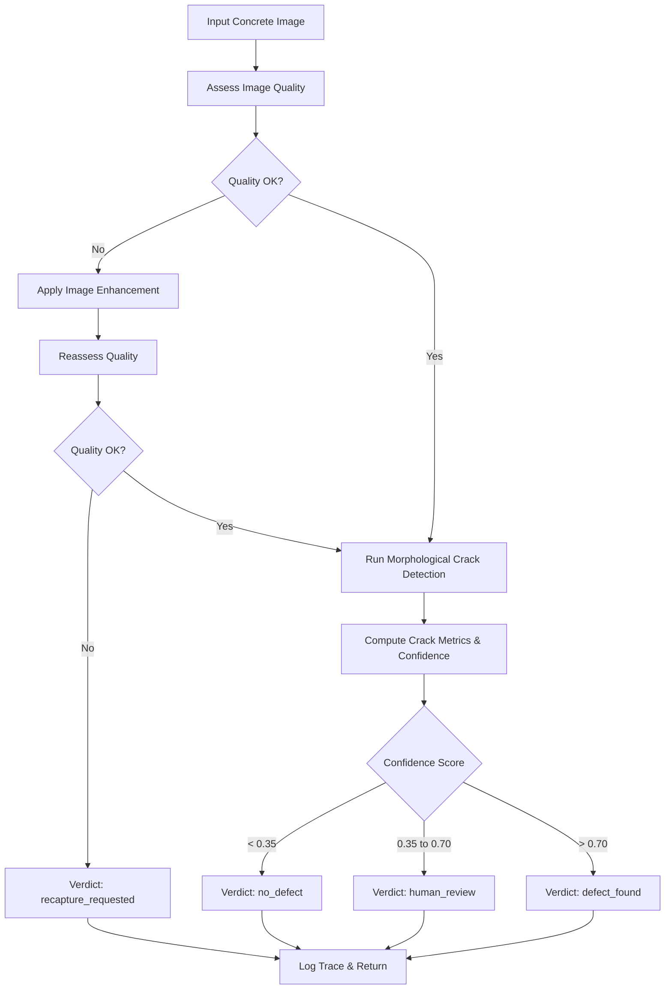

# Sentry — Agentic Concrete Crack Inspection System

[](https://opencv.org/)
[](https://www.python.org/)
[](LICENSE)

An agentic surface-defect inspection system focused strictly on **concrete surface crack detection** from a single photograph, developed for the **OpenCV AI Competition 2026**.

---

## 1. Project Overview & Problem Statement

Civil infrastructure—including bridges, buildings, tunnels, and retaining walls—requires continuous monitoring to detect surface fissures before structural deterioration progresses. Traditional manual inspection is labor-intensive, hazardous, and subjective. However, generic computer vision classifiers often fail in real-world conditions due to poor lighting, motion blur, or confusing surface textures (e.g., aggregate exposure, formwork seams, broomed finishes).

**Sentry** addresses this challenge through an autonomous **perception → decision → action loop**:
1. It verifies the optical quality of the uploaded concrete image (checking blur, exposure, and contrast).
2. If image quality is deficient, the agent autonomously applies enhancement filters and reassesses.
3. If quality remains below threshold, it requests a recapture rather than generating an unreliable verdict.
4. When acceptable, it runs morphological crack detection, estimates crack geometry, and computes a confidence score.
5. Crucially, uncertain results trigger a `human_review` referral rather than a false negative or false positive.

The agent returns exactly one of four definitive verdicts:
- `defect_found`
- `no_defect`
- `recapture_requested`
- `human_review`

> **Responsible Engineering Notice**: Sentry is an image-based inspection aid, not a substitute for a licensed professional structural engineer. The system detects visual surface discontinuities; it cannot determine internal structural integrity or hazard levels. Pixel dimensions reflect image geometry and do not constitute physical metric measurements unless formal camera calibration is established.

---

## 2. Planned Architecture & Technology Stack

### Technology Stack
- **Core Vision Runtime:** OpenCV 5.x (`cv2.__version__` must start with `5.`; OpenCV 4.x fallbacks are strictly prohibited).
- **Language & Runtime:** Python 3.10 or 3.11 (tested on Python 3.13 in active dev environment).
- **Numerical & ML Core:** NumPy, Pandas, Scikit-learn.
- **Backend API:** FastAPI with ASGI server Uvicorn.
- **User Interface:** Streamlit (interactive inspection dashboard with image overlay and trace view).
- **Cloud Infrastructure (AWS):** Amazon S3 (imagery and results storage), Amazon CloudWatch (structured logs), Amazon EC2 (containerized hosting via IAM roles; boto3 SDK).
- **Testing & Verification:** pytest.

### Planned Agentic Loop (Perception → Decision → Action)


---

## 3. Repository Structure

```text
Sentry/
├── src/
│   ├── __init__.py           # Package initializer
│   ├── perception/
│   │   ├── __init__.py       # Perception package initializer
│   │   ├── quality.py        # Blur, brightness, contrast checks & enhancement (Implemented)
│   │   └── cracks.py         # Morphological crack detector & metric measurement (Implemented)
│   ├── agent/
│   │   ├── __init__.py       # Agent package initializer
│   │   ├── planner.py        # Rule-based perception-decision-action loop (Implemented)
│   │   └── trace.py          # Structured JSON step trace logger (Implemented)
│   └── api/
│       ├── __init__.py       # API package initializer
│       └── main.py           # FastAPI endpoints: GET /health, POST /inspect (Implemented)
├── tests/
│   ├── check_env.py          # Environment & OpenCV 5.x verification script (Implemented)
│   ├── test_perception.py    # Unit tests for quality, enhancement & cracks (Implemented)
│   ├── test_agent.py         # Unit tests for planner logic, triage & tracing (Implemented)
│   └── test_api.py           # Integration tests for FastAPI endpoints (Implemented)
├── eval/
│   └── run_eval.py           # Evaluation pipeline for labeled benchmarks (Planned)
├── docs/                     # Architecture designs, specifications, and notes
├── infra/                    # Cloud infrastructure deployment configs (Planned)
├── data/                     # Local data root (gitignored)
│   ├── dev/                  # Development and calibration images
│   └── test/                 # Benchmark holdout evaluation images
├── app.py                    # Streamlit web UI with inspector overlay & trace (Implemented)
├── requirements.txt          # Explicitly pinned project dependencies
├── .gitignore                # Git exclusions (credentials, venvs, data, caches)
├── README.md                 # Project documentation
├── DATASETS.md               # Dataset governance, provenance, and split policy
└── DECISIONS.md              # Architectural decision log
```

---

## 4. Current Implementation Status vs. Planned Work

| Module / Component | Status | Implementation Details |
|---|---|---|
| **Repository Skeleton** | **Implemented** | Directory hierarchy, initial packages, and `.gitignore` created |
| **Environment Verification** | **Implemented** | `tests/check_env.py` verified; checks Python & OpenCV 5.x |
| **Requirements Specification**| **Implemented** | `requirements.txt` pinned to tested packages (`opencv-python-headless==5.0.0.93`, etc.) |
| **Documentation & Decisions** | **Implemented** | `README.md`, `DATASETS.md`, `DECISIONS.md` created |
| **Perception (`quality.py`)** | **Implemented** | Blur (Laplacian var), brightness, contrast, issues list, and CLAHE enhancement |
| **Perception (`cracks.py`)** | **Implemented** | Black-hat morphology, noise-floor thresholding, contour filtering, and heuristic confidence |
| **Perception Unit Tests** | **Implemented** | `tests/test_perception.py` (20 synthetic tests passing) |
| **Agent Loop (`planner.py`)** | **Implemented** | 6-step capped perception-decision-action loop with 4 verdicts |
| **Trace Logger (`trace.py`)** | **Implemented** | Structured, audited JSON-safe step tracing without raw image dumps |
| **Agent Unit Tests** | **Implemented** | `tests/test_agent.py` (20 tests covering boundaries, branches & errors) |
| **FastAPI Backend (`main.py`)**| **Implemented** | `GET /health` and `POST /inspect` REST endpoints with base64 PNG mask |
| **Streamlit UI (`app.py`)** | **Implemented** | Interactive upload, inspection overlay, trace timeline, and human review queue |
| **API Integration Tests** | **Implemented** | `tests/test_api.py` (10 tests covering upload, decode, limits & errors) |
| **Benchmark Script (`eval/`)** | *Planned (Next Task)* | Precision, recall, and confusion matrix against labeled datasets |
| **AWS Cloud Deployment** | *Planned* | Docker container on EC2, S3 bucket storage, and CloudWatch |

---

## 5. Prerequisites & Environment Setup

### Prerequisites
- Python 3.10, 3.11, or 3.13 (64-bit).
- `pip` package manager (version 24.0+ recommended).

### Setting Up a Virtual Environment

#### On Windows (PowerShell):
```powershell
# Create a virtual environment named .venv
python -m venv .venv

# Activate the virtual environment
.\.venv\Scripts\Activate.ps1

# Upgrade pip to latest version
python -m pip install --upgrade pip

# Install pinned dependencies
python -m pip install -r requirements.txt
```

#### On Linux / macOS (bash):
```bash
# Create a virtual environment named .venv
python3 -m venv .venv

# Activate the virtual environment
source .venv/bin/activate

# Upgrade pip and install dependencies
pip install --upgrade pip
pip install -r requirements.txt
```

---

## 6. How to Verify the Environment

Execute the verification script:

```bash
python tests/check_env.py
```

Expected output upon success:
```text
Python Version: 3.x.y (...)
OpenCV Version: 5.0.0
[SUCCESS] Environment verification passed: Python runtime is operational and OpenCV 5.x is active.
```

If OpenCV is missing or its version does not begin with `5.`, the script terminates with exit code `1` and prints an explicit error.

---

## 7. Local Execution & Testing Commands

- **Run Environment Verification:**
  ```bash
  python tests/check_env.py
  ```
- **Run Complete Test Suite (Perception, Agent, API):**
  ```bash
  pytest -v tests/
  ```
- **Launch FastAPI Backend Service:**
  ```bash
  uvicorn src.api.main:app --host 0.0.0.0 --port 8000 --reload
  ```
- **Launch Streamlit Web Dashboard:**
  ```bash
  streamlit run app.py
  ```
- **Run Evaluation on Benchmark Dataset (Planned Next Task):**
  ```bash
  python eval/run_eval.py --data-dir data/test
  ```

---

## 8. Planned AWS Deployment Approach

The deployment architecture is designed for reproducible containerized execution:
1. **Containerization:** A Docker container encapsulating the OpenCV 5 runtime, FastAPI backend, and Streamlit frontend.
2. **Compute:** Deployed to an AWS EC2 instance.
3. **Storage & Assets:** Amazon S3 for storing incoming inspection photos, generated diagnostic overlays, and trace logs.
4. **Monitoring:** Amazon CloudWatch for collecting structured JSON application traces and monitoring operational metrics.
5. **Security & Credentials:**
   - **No hardcoded credentials.** IAM roles assigned directly to the EC2 instance provide scoped access to S3 and CloudWatch.
   - S3 bucket names and AWS regions will be supplied via environment variables (`AWS_REGION`, `SENTRY_S3_BUCKET`).
6. **Optional Future Enhancements:** Amazon Bedrock integration for inspection report synthesis; COOL library benchmarking on AWS Graviton.

---

## 9. Known Limitations

1. **Concrete Surface Scope Only:** The system is specialized for concrete cracks. It is not designed to assess masonry, wood, asphalt, or steel structures.
2. **Visual Assessment Only:** Visual crack detection cannot establish internal structural depth, sub-surface voids, or load-bearing capability.
3. **No Uncalibrated Physical Measurements:** Crack lengths and widths computed from pixels represent image space metrics. Without an in-plane fiducial scale or camera intrinsics, they must not be interpreted as millimeters.
4. **Environmental Sensitivity:** Uneven shadowing, wet surfaces, grease stains, and formwork joints can produce false-positive responses. The agent mitigates this via quality enhancement and the `human_review` fallback verdict.
5. **Pre-Evaluation State:** Real-world benchmark accuracy has not yet been computed, as no labeled test dataset has been ingested or evaluated in this initial skeleton milestone.
